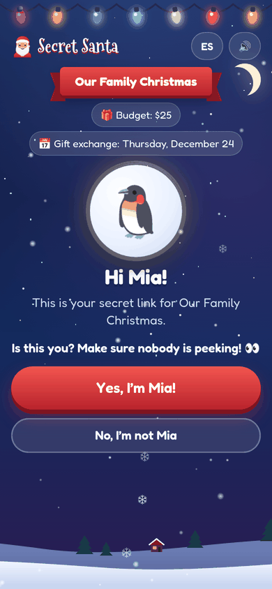
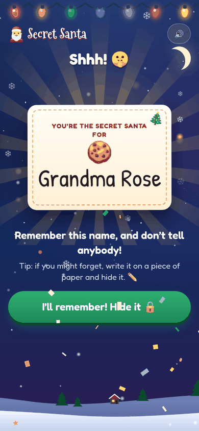
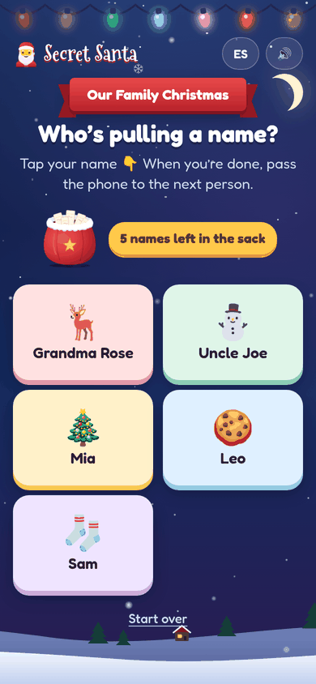

# 🎅 Secret Santa

**Live site: https://alejandrothiessen.github.io/secret-santa/**

A free, private Secret Santa draw that runs in any phone's web browser. Put everyone's name in Santa's sack, then each person pulls one out, with a shaking sack, flying paper slips, confetti and sleigh bells.

- Nobody ever gets their own name, and every name gets pulled exactly once.
- After you see your name, you tap **Hide it 🔒**: it turns into snowflakes, and nobody can look at it again on that phone.
- Kids without a phone can use a grown-up's phone, and the grown-up can't peek afterward.
- English and Spanish (tap **EN / ES**), sound on or off, and it works on older phones and iPads too.

  
  
  
  

## Two ways to pull names

**Everyone on their own phone (secret links).** The organizer types the names and gets one secret link per person to send by text or WhatsApp. Each person opens their own link, taps "Yes, I'm …", and pulls a name. For a kid without a phone, send the kid's link to a parent, who opens it and hands the phone to the kid.

**One phone, pass it around.** For when everyone is in the same room. Each person taps their own name, pulls a name out of the sack, hides it, and passes the phone along. Pulled names come out of the sack, and the phone keeps no record of who got whom.

## Put it on GitHub Pages (free, about 5 minutes)

1. Sign in at [github.com](https://github.com) and click **New repository**. Name it `secret-santa`, make it **Public**, and click **Create repository**.
2. On the new repository's page, click **uploading an existing file**, drag in everything from this folder (`index.html` and the `css`, `js`, `img`, `docs` and `test` folders), and click **Commit changes**.
3. Go to **Settings → Pages**. Under "Build and deployment" choose **Deploy from a branch**, branch **main**, folder **/ (root)**, and click **Save**.
4. After a minute or two the site is live at `https://YOUR-USERNAME.github.io/secret-santa/`.
5. For the picture in WhatsApp and Facebook link previews, `index.html` points at the full address of `img/preview.jpg` (`og:image` and `og:url`, set for alejandrothiessen.github.io). If you copy the site to another account, change those two addresses.

Organize from the phone or computer you'll keep using: the organizer page is saved on that device, so you can come back later to send more links.

## Good to know

- **There is no server.** GitHub only hosts the page. The names stay on the phones, except inside the links you send.
- **Each link holds its own result, scrambled.** That's how it works without a server: a link carries one person's name and who they got, scrambled so it can't be read from the address. Treat links as private and send each one only to its person (or to a kid's parent).
- **The lock is per phone.** Once a name is hidden, that link shows "Already pulled 🤫" on that phone. If someone truly forgot, they can open their own link again on a different phone or browser.
- **The organizer is on the honor system.** The organizer's page holds every link (so they can be sent) but never shows who got whom. Don't open other people's links!
- **Pass-the-phone keeps no record.** If someone forgets their name, the only fix is to start over and have everyone pull again, so the page suggests writing the name on a piece of paper.
- **Need to add someone?** Tap **Start over** on the organizer page. The names are kept, but everyone needs a new link (old links still show the old draw).

## Files

| File | What it does |
|---|---|
| `index.html` | the page |
| `css/style.css` | the look and the animations |
| `js/logic.js` | the drawing rules: no self-picks, no repeats, the scrambled links |
| `js/app.js` | the screens and buttons |
| `js/fx.js` | snow, confetti, sparkles and sounds |
| `js/i18n.js` | every text, in English and Spanish |
| `test/logic.test.js` | tests for the drawing rules: `node --test test/logic.test.js` |
